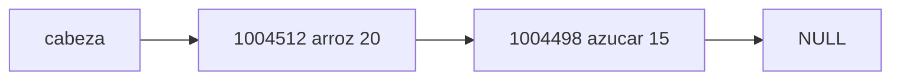

# Informe del avance

## 1. El escenario

Es el inventario de una tienda el cual guarda cada articulo con su respectivo código numerico, nombre y cantidad. No se puede repetir el código numerico de un articulo, pues este va ligado a un producto; esto permite llevar un control de inventario, agregar y eliminar productos, consultar inventario, reponer cantidad y listar todos los productos. Este puede ser util para tiendas que busquen ordenar sus inventarios.

## 2. Qué guarda la estructura y qué operaciones necesita

Cada nodo de la lista guarda el código del artículo, su nombre, su cantidad y el enlace al nodo siguiente. La estructura guarda además el puntero a la cabeza.

| Operación | Qué hace | Precondición |
|---|---|---|
| AGREGAR c nombre cantidad | inserta un articulo nuevo | el código c no esta en el inventario |
| ELIMINAR c | quita el articulo y libera su nodo | c esta en el inventario |
| CONSULTAR c | escribe código, nombre y cantidad | c esta en el inventario |
| REPONER c cantidad | suma cantidad al articulo | c esta en el inventario |
| LISTAR | escribe todos los artículos, uno por linea | ninguna |

## 3. Porque lista enlazada simple

Frente a un arreglo los artículos entran y salen en cualquier momento y en cualquier posición, porque se eliminan por código. Con un arreglo eliminar uno del medio obliga a desplazar todos los que están después, y si se llena hay que pedir un arrglo mas grande y copiar todo. En la lista una vez encontrado el nodo, eliminarlo es reenlazar dos punteros y liberarlo, y no hay capacidad maxima que fijar al crearlo. 
Contra una lista ordenada mantener el orden por código costaría insertar en su lugar, cosa que no se necesita pues ninguna operación del escenario requiere tener los artículos ordenados. Una lista doble cada nodo llevaría un puntero mas, lo que solo aportaría poder ir hacia atrás, lo cual no es necesario. 
Lo que perdemos al usar la lista enlazada simple es que no hay acceso directo por código, asi que casi todo es $O(n)$; esto es lo que la tabla hash ataca. Los costos de buscar, insertar y eliminar en una lista enlazada simple, y la comparación con el arreglo,se estudian en R. Thareja, *Data Structures Using C* (2018), capítulo 6, sección 6.2.
Por todo lo anterior considero que la lista enlazada simple es la opción mas adecuada para lo que busca el escenario que se evalúa. 

Costos esperados, con $n$ el número de elementos:

| Operación | Tiempo | Espacio extra | Razón |
|---|---|---|---|
| `AGREGAR` | $O(n)$ | $O(1)$ | recorre la lista buscando el código repetido y luego inserta en $O(1)$ |
| `ELIMINAR` | $O(n)$ | $O(1)$ | recorre hasta el nodo y reenlaza al anterior con el siguiente |
| `CONSULTAR` | $O(n)$ | $O(1)$ | búsqueda lineal; en el peor caso el código está al final o no está |
| `REPONER` | $O(n)$ | $O(1)$ | busca el nodo y modifica la cantidad |
| `LISTAR` | $O(n)$ | $O(1)$ | visita cada nodo una sola vez |
Los invariantes de la estructura, como fórmulas:

$$I_1:\quad \forall i,j \in [0,n):\; i \neq j \Rightarrow c_i \neq c_j$$

$$I_2:\quad p_0 = \text{cabeza} \;\wedge\; \forall i \in [0,n-1):\; p_i.\text{sig} = p_{i+1} \;\wedge\; p_{n-1}.\text{sig} = \text{NULL}$$

Con la lista vacía ($n=0$) se cumple $\text{cabeza} = \text{NULL}$.

Un diagrama del estado de la estructura, en Mermaid:

## 4. Qué piensan medir

 **Qué se mide.** Queremos saber cuánto tarda `CONSULTAR` en la lista
enlazada a medida que crece el número de artículos $n$.
Mediremos con $n$ = 1000, 2000, 4000, 8000, 16000 artículos (cada tamaño es el doble que el anterior).
En cada tamaño haremos miles de consultas seguidas y dividiremos el tiempo total entre el numero de consultas para obtener el tiempo de una.
Usando dos casos:
- Peor caso: consultamos un código que no exista, así que se recorren todos los nodos y nos devolverá que no existe.
- Caso intermedio: consultamos un código que está cerca de la mitad de la lista, así que se recorren cerca de la mitad de los nodos.

**Condiciones fijas.** Todas las corridas van en la misma máquina(11th Gen Intel(R) Core(TM) i5-11400H @ 2.70GHz (2.69 GHz),16GB ram y windows 11), con el mismo compilador (GCC-16.2.0) y las mismas banderas (-Wall -Wextra -O2).

**Qué esperamos ver.** Como la búsqueda recorre la lista, el costo en el peor caso es $T(n) = \Theta(n)$. Por eso esperamos que al duplicar $n$ el tiempo también se duplique:

$$T(2n) \approx 2\,T(n)$$

Al final buscamos compararlo con la tabla hash en sus tres tamaños de tabla y con 'map'. En el cuarto juego de códigos esperamos que la tabla se comporte como la lista, pues todos caen en la misma cubeta.

**Orden de LISTAR.** Insertamos al final de la lista, así que `LISTAR` sale en el mismo
orden en que llegaron los artículos. La tabla hash recorre cubeta por cubeta, así que su
orden depende de la función hash. Para igualar el orden en las dos habría que ordenar la
salida de ambas por código antes de escribirla.

## 5. Casos de prueba

| Caso | Entrada | Salida esperada | Salida obtenida |
|---|---|---|---|
| funcional 1 | ejemplo del enunciado (7 órdenes con arroz y azúcar) | `ok`, `ok`, `1004512 arroz 20`, `ok`, `1004498 azucar 15`, `ok`, `no existe` | |
| funcional 2 | `AGREGAR 1 sal 5`, `AGREGAR 1 pan 3`, `CONSULTAR 1` | `ok`, `repetido`, `1 sal 5` | |
| funcional 3 | `REPONER 9 4`, `ELIMINAR 9`, `CONSULTAR 9` | `no existe`, `no existe`, `no existe` | |
| límite | `LISTAR` con el inventario vacío | no escribe nada | |

Escogi el inventario vacío como caso límite porque es el estado inicial de la estructura y el que más fácil rompe una implementación: `LISTAR` debe recorrer cero nodos sin fallar y sin escribir nada.

