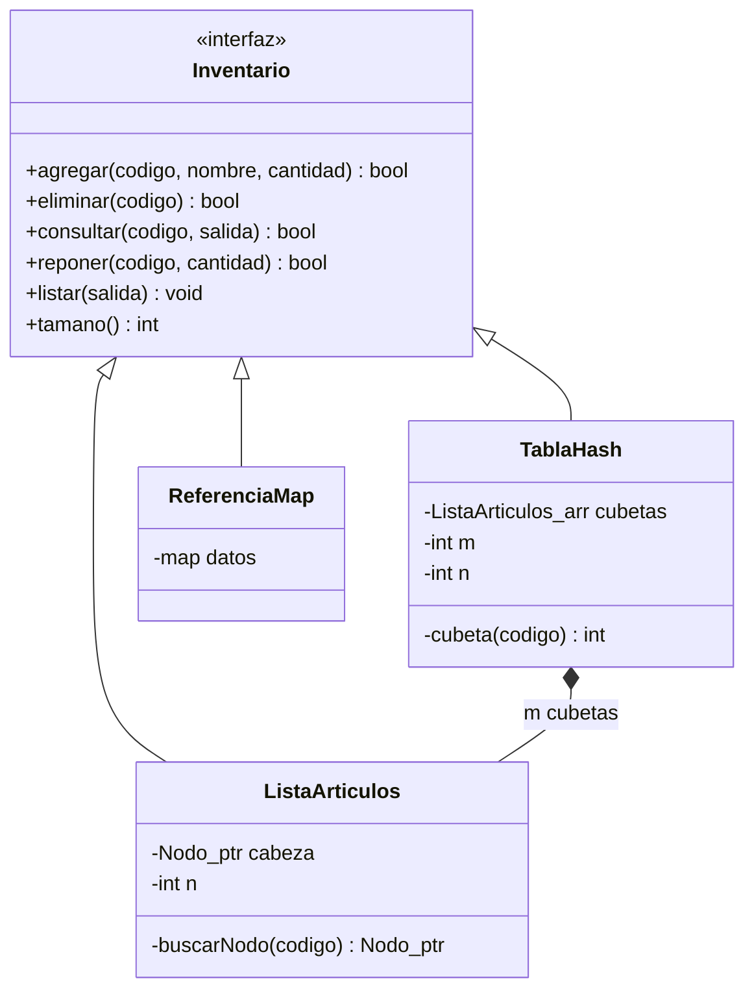
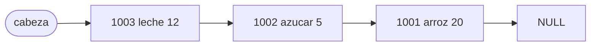
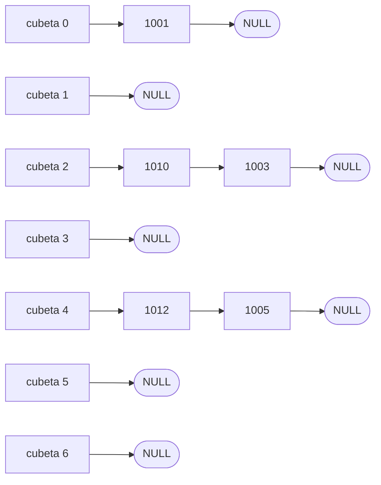
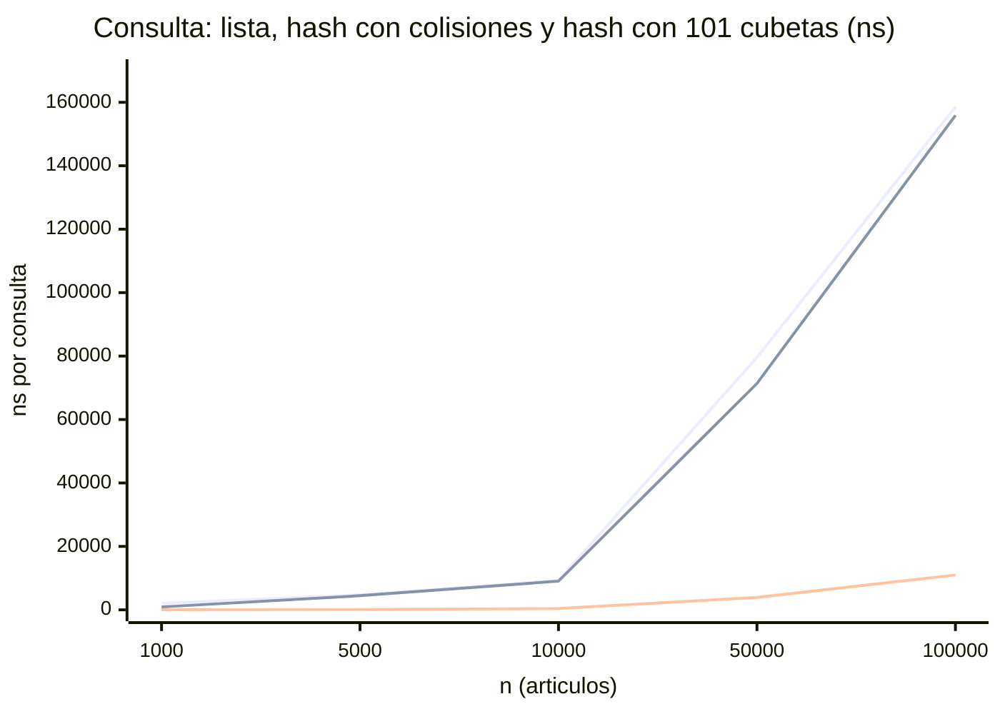
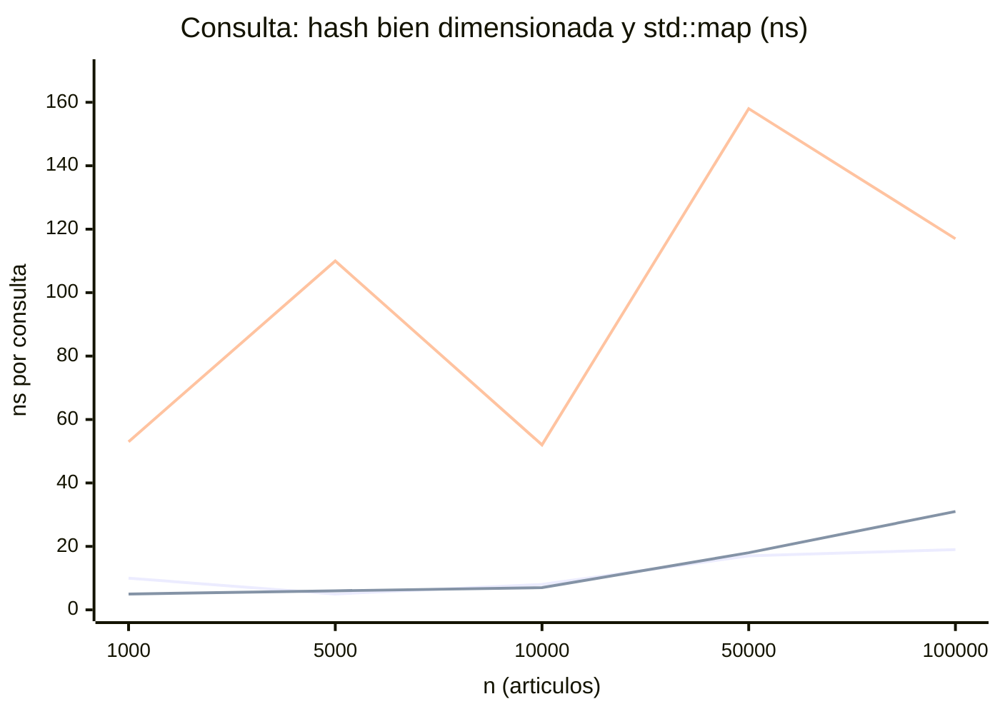

# Informe final
 
**Escenario A — Inventario de una tienda.** Integrantes: Jesús Esteban Monroy (9029007), Alejandro Serna Tovar (9030159), Juan José Guzmán (9030825).
 
## 1. El escenario y el modelado
 
Este programa implementa un sistema de gestión de inventario diseñado para ser utilizado por el administrador o el personal de una tienda. Su propósito principal es mantener un registro actualizado y preciso de las existencias de mercancía, garantizando que cada producto sea único según su código. A través de este sistema, el usuario puede registrar nuevos productos, consultar el stock disponible, reponer unidades de mercancía existente y eliminar artículos que ya no se comercializan.
 
Cada elemento es un `Articulo` con `codigo` (entero `long long`), `nombre` (arreglo de `char` de 64 posiciones, sin `string` de la STL) y `cantidad` (entero). La estructura guarda a lo sumo un artículo por código.
 
| Operación | Qué hace | Precondición |
|---|---|---|
| `AGREGAR c nombre cantidad` | Guarda un artículo nuevo; responde `repetido` si el código ya estaba. | `nombre` es una palabra no vacía de a lo sumo 63 caracteres. |
| `ELIMINAR c` | Quita el artículo con ese código; `no existe` si no está. | Ninguna. |
| `CONSULTAR c` | Escribe `c nombre cantidad`; `no existe` si no está. | Ninguna. |
| `REPONER c cantidad` | Suma `cantidad` a las existencias; `no existe` si no está. | Ninguna. |
| `LISTAR` | Escribe todos los artículos, uno por línea. | Ninguna. |
 
## 2. Las estructuras
 
Las tres estructuras implementan la misma interfaz `Inventario` (`codigo/Inventario.h`). `principal.cpp` y `medir.cpp` solo usan un `Inventario*`; la única función que conoce las clases concretas es `crearInventario` (`codigo/Fabrica.cpp`). Se escoge la estructura al ejecutar:
 
```
./proyecto lista < ../datos/ejemplo1.in
./proyecto hash < ../datos/ejemplo1.in        # 1009 cubetas por defecto
./proyecto hash 7 < ../datos/ejemplo1.in      # 7 cubetas
./proyecto map < ../datos/ejemplo1.in
```
 

 
Como la lista, la hash y el map tienen las mismas funciones (agregar, consultar, eliminar, reponer, listar), `principal.cpp` y `medir.cpp` se escriben una sola vez y sirven para cualquiera de las tres sin cambiar el código. Además la comparación queda justa, porque a las tres se les hacen las mismas operaciones con los mismos datos.
 
### 2.1 Lista enlazada simple (avance)
 
Se eligió una lista enlazada simple porque permite la inserción de nuevos elementos de forma rápida sin preocuparse por los redimensionamientos costosos de un arreglo. Como se inserta siempre al inicio, la operación agregar solo toma $O(1)$ al enlazar el nodo (aunque requiere un recorrido $O(n)$ previo para evitar repetidos). Las operaciones de búsqueda exigen un recorrido secuencial porque la lista no está ordenada por código, resultando en tiempos de $O(n)$. Al eliminar, no hay que desplazar elementos; basta desenlazar el nodo (el `anterior` pasa a apuntar al `siguiente`) en tiempo $O(1)$ tras encontrarlo.
 
Estado después de agregar 1001, 1002 y 1003:
 

 
### 2.2 Tabla hash con encadenamiento (final)
 
Arreglo de $m$ cubetas creado con `new ListaArticulos[m]`; cada cubeta es una lista del avance. Función hash por división:
 
$$h(c) = c \bmod m$$
 
Ejemplo con $m = 7$, agregando en orden 1001, 1003, 1005, 1010 y 1012. Como $1003 \bmod 7 = 1010 \bmod 7 = 2$ y $1005 \bmod 7 = 1012 \bmod 7 = 4$, hay dos colisiones; como cada cubeta inserta por la cabeza, el último que llegó queda primero:
 

 
Calcular `h(c) = c % m` es una sola operación de módulo, así que no depende de cuántos artículos hay. Después se recorre solo la lista de esa cubeta.
 
En C++, `%` con un número negativo da un resto negativo. Por ejemplo, `-7 % 5 = -2`, y -2 no sirve como índice del arreglo. Al sumarle m queda dentro del rango [0, m−1]: -2 + 5 = 3. Así cualquier código, positivo o negativo, cae en una cubeta válida.
 
### 2.3 `std::map` (referencia)
 
`ReferenciaMap` usa `std::map<long long, Articulo>`, un árbol rojinegro de la biblioteca estándar. Se usa tal cual, solo para comparar.
 
## 3. Análisis formal de complejidad
 
### 3.1 Lista enlazada
 
**Modelo de costo.** El paso básico que contamos es preguntar si el nodo actual es el código que necesitamos (`actual->dato.codigo != codigo`). Cada una de esas comparaciones cuesta 1.
 
**consultar.**
 
**Teorema.** En el peor caso, `consultar` en la lista cuesta $T(n) \in O(n)$.
 
**Demostración.** Se procede de forma directa, contando las operaciones de `buscarNodo` en el peor caso. El peor caso es que recorramos toda la lista, es decir, que el código no esté o sea el último.
 
*Desarrollo.* `actual = cabeza` es una asignación, así que cuesta 1, y `return actual` cuesta 1; las dos se hacen una sola vez. En cada vuelta se hacen 2 comparaciones (`actual != NULL` y `dato.codigo != codigo`) y 1 asignación (`actual = actual->sig`), o sea 2 + 1 = 3. En el peor caso el ciclo da n vueltas: 3n. Falta la última revisión de la condición, la que da falso y saca del ciclo (cuando `actual` llega a `NULL`), que son 2 comparaciones más:
 
$$T(n) = 1 + 3n + 2 + 1 = 3n + 4 \leq 7n \quad \text{para todo } n \geq 1$$
 
porque $4 \le 4n$ cuando $n \ge 1$. Con $n = 0$ no se cumple ($4 \le 0$ es falso), por eso $k = 1$.
 
Si `actual` llega a NULL, por el cortocircuito del `&&` en esa última revisión solo se hace 1 comparación y quedaría 3n + 3. Contamos las 2 para tener una cota superior; las dos cuentas dan $O(n)$.
 
*Conclusión.* Por lo tanto, $T(n) \in O(n)$ con testigos $c = 7$ y $k = 1$.
 
**agregar.** Es $O(n)$ porque antes de insertar tiene que recorrer todos los valores de la lista con `buscarNodo` para revisar que el código no esté repetido. Enganchar el nodo en la cabeza es $O(1)$: si no hubiera que revisar repetidos y ya supiéramos la posición, `agregar` sería $O(1)$.
 
**eliminar.** Es $O(n)$ porque el ciclo avanza nodo por nodo: `anterior` pasa a ser `actual` y `actual` pasa al siguiente, y en el peor caso recorre los n nodos. `anterior` hace falta porque en una lista simple no se puede ir hacia atrás: para borrar el 30 en 50 → 40 → 30 → 20, el 40 ya no debe apuntar al 30 sino al 20 (`anterior->sig = actual->sig`). Si el que se borra es la cabeza, `anterior` vale `NULL`, y como 50 es la cabeza, al borrarla la cabeza pasa a ser 40 (`cabeza = actual->sig`).
 
**reponer.** Es $O(n)$: buscar cuesta $O(n)$ y sumar la cantidad cuesta $O(1)$, y en la suma manda el más grande.
 
**listar.** Es $\Theta(n)$: no busca nada, tiene que imprimir todos los artículos uno por uno, así que nunca se detiene antes. Con 5 artículos imprime 5 veces.
 
**tamano.** Es $O(1)$: no lee uno por uno, porque la variable `n` ya guarda cuántos hay (se suma 1 en `agregar` y se resta 1 en `eliminar`).
 
**Invariantes.** Llamamos $x_0, x_1, \dots, x_{n-1}$ a los nodos en orden desde la cabeza.
 
$$(I_1)\quad n = \text{número de nodos alcanzables desde } \mathit{cabeza}$$
 
La variable n es igual a los datos que hay en la lista.
 
$$(I_2)\quad \forall i, j \in [0, n):\ i \neq j \Rightarrow x_i.\mathit{codigo} \neq x_j.\mathit{codigo}$$
 
Nunca hay dos nodos con el mismo código.
 
### 3.2 Tabla hash
 
**Función hash.** Calcular `h(c) = c % m` cuesta $O(1)$: es una sola operación de módulo y no depende de cuántos artículos hay.
 
**consultar, peor caso.** Si todos caen en la misma cubeta, la tabla se parece a una lista enlazada: una sola cadena con los n elementos. `consultar` pasa a ser $O(n)$.
 
Calcular h(c) cuesta 4 operaciones, así que en el peor caso $T(n) = 3n + 4 + 4 = 3n + 8$. Tomamos $k = 1$ y $c = 11$. Cuando $n \ge 1$, el 8 es menor o igual que $8n$, entonces $3n + 8 \le 3n + 8n = 11n$. Con eso queda que $3n + 8 \le 11 \cdot n$ para todo $n \ge 1$, y por eso la hash en el peor caso es $O(n)$. También sirve $c = 4$ con $k = 8$, porque desde $n = 8$ se cumple $3n + 8 \le 4n$.
 
**consultar, caso promedio.** Si se reparten parejo, cada cubeta tiene n/m artículos (el factor de carga $\alpha = n/m$), y consultar cuesta $O(1 + \alpha)$. Si m = n, toca más o menos 1 por cubeta y `consultar` queda en $O(1)$ en promedio.
 
**agregar, eliminar, reponer.** Las tres primero calculan h(c) = c % m, que es una sola operación y cuesta $O(1)$. Después trabajan sobre la lista de esa cubeta, así que su costo depende de cuántos artículos tenga la cubeta. En el peor caso todos los códigos caen en la misma cubeta, esa lista tiene n elementos y las operaciones son $O(n)$. En promedio, si los códigos se reparten parejo, cada cubeta tiene unos n/m artículos y el costo es $O(1 + n/m)$. Si m es parecido a n, eso queda en $O(1)$.
 
**listar.** La tabla es un arreglo de m cubetas y no tiene forma de saber cuáles están vacías sin mirarlas una por una. Por eso `listar` revisa las m posiciones y además recorre los n artículos: queda en $\Theta(n + m)$.
 
**Invariantes.** Sea $T_j$ el conjunto de artículos de la cubeta $j$.
 
$$(H_1)\quad \forall j \in [0, m):\ \forall x \in T_j:\ h(x.\mathit{codigo}) = j$$
 
$$(H_2)\quad n = \sum_{j=0}^{m-1} |T_j|$$
 
$H_1$: cada artículo está guardado en la cubeta que le corresponde. Si un artículo x está en la cubeta j, es porque h(x.codigo) da j. Ningún artículo queda en una cubeta equivocada, y por eso consultar solo tiene que buscar en una cubeta.
 
$H_2$: el número total de artículos n es la suma de los tamaños de todas las cubetas. Ningún artículo se pierde ni se cuenta dos veces.
 
### 3.3 Resumen
 
| Operación | Lista | Hash: peor caso | Hash: promedio | `std::map` |
|---|---|---|---|---|
| `AGREGAR` | $O(n)$ | $O(n)$ | $O(1 + \alpha)$ | $O(\log n)$ |
| `ELIMINAR` | $O(n)$ | $O(n)$ | $O(1 + \alpha)$ | $O(\log n)$ |
| `CONSULTAR` | $O(n)$ | $O(n)$ | $O(1 + \alpha)$ | $O(\log n)$ |
| `REPONER` | $O(n)$ | $O(n)$ | $O(1 + \alpha)$ | $O(\log n)$ |
| `LISTAR` | $\Theta(n)$ | $\Theta(n + m)$ | $\Theta(n + m)$ | $\Theta(n)$ |
| Espacio total | $\Theta(n)$ | $\Theta(n + m)$ | $\Theta(n + m)$ | $\Theta(n)$ |
 
Con $\alpha = n/m$ el factor de carga.
 
## 4. Experimentos
 
**Cómo se midió.**
- Programa: `codigo/medir.cpp`, con el objetivo `make mediciones`. Los datos crudos están en `datos/mediciones.csv`.
- Máquina: portátil Acer Predator Helios Neo 16 (PTN16-51), 16 GB de RAM, Windows con WSL Ubuntu.
- Compilador: `g++` 15.2 con `-Wall -Wextra -O2`, las mismas banderas para todo.
- Tamaños: $n$ = 1000, 5000, 10000, 50000 y 100000.
- Entradas: se cargan $n$ artículos con códigos distintos de 7 cifras o más, mezclados con $1000000 + (i \cdot 1000003) \bmod 900000007$. Luego se hacen 2000 consultas: las pares buscan un código que está y las impares uno que no está. Se reporta el tiempo total dividido entre 2000.
- Juego de colisión: los códigos son múltiplos del número de cubetas, $c_i = (i + 1) \cdot 1009$, así que $c_i \bmod 1009 = 0$ y todos caen en la cubeta 0.
- Repeticiones: se corrió `make mediciones` dos veces; la primera tuvo un valor anómalo en la lista (n = 5000 más lento que n = 10000) por interferencia del sistema, y se usa la segunda.

| Configuración | Estructura | Cubetas |
|---|---|---|
| lista | lista enlazada | — |
| hash (101) | tabla hash, tabla pequeña | 101 |
| hash (n) | tabla hash, tabla cercana a n | n |
| hash (200003) | tabla hash, primo mayor que n | 200003 |
| hash colisión | tabla hash, todos en una cubeta | 1009 |
| map | `std::map` | — |

**Tiempo promedio por consulta (nanosegundos):**
 
| n | lista | hash (101) | hash (n) | hash (200003) | hash colisión (1009) | map |
|---:|---:|---:|---:|---:|---:|---:|
| 1000 | 2054 | 17 | 10 | 5 | 919 | 53 |
| 5000 | 4762 | 110 | 5 | 6 | 4451 | 110 |
| 10000 | 9263 | 402 | 8 | 7 | 9046 | 52 |
| 50000 | 79576 | 3908 | 17 | 18 | 71363 | 158 |
| 100000 | 158567 | 10971 | 19 | 31 | 155883 | 117 |
 
**Gráfica 1: estructuras con costo lineal.** Líneas en orden: lista, hash colisión, hash (101).
 

 
**Gráfica 2: estructuras rápidas** (en la gráfica 1 quedan pegadas al cero). Líneas en orden: hash (n), hash (200003), map.
 

 
## 5. Lo medido contra lo predicho
 
**Hash con colisión contra lista (158.567 ns contra 155.883 ns con n = 100.000).** Son casi iguales porque si todos los códigos caen en la misma cubeta, la tabla hash deja de ser hash: queda una sola cubeta con una lista de los 100.000 artículos. Para consultar, la hash calcula `h(c)` (eso es $O(1)$ y casi no cuesta) y después recorre esa lista igual que la lista normal. Las dos son $O(n)$. La diferencia de unos pocos ns es ruido de la medición o de la máquina.
 
**Hash con 101 cubetas (de 17 ns a 10.971 ns).** Si los artículos se reparten parejo, con n = 100.000 hay 100.000 / 101 ≈ 990 artículos por cubeta. Cada consulta encuentra la cubeta en $O(1)$, pero después recorre una lista de unos 990 elementos (en promedio la mitad si el código sí está). El costo es $O(1 + n/m)$. Como m se queda fijo en 101 y n crece, el tiempo crece de forma lineal con n. Con n pequeño había 1 o 2 artículos por cubeta y por eso daba 17 ns. La tabla tiene muy pocas cubetas para tantos datos: el factor de carga $\alpha = n/m$ es altísimo.
 
**Lista.** El tiempo creció 158.567 / 9.263 ≈ 17,1 veces, mientras que n creció 10 veces. Sí coincide con $O(n)$: el tiempo aumenta en proporción a la cantidad de datos, porque para consultar hay que recorrer la lista nodo por nodo. Que salga 17 y no 10 exacto se explica porque con 100.000 nodos la memoria ya no cabe en la caché del procesador y cada salto de `actual->sig` es más lento. Eso cambia la constante, pero no la forma lineal.
 
**Hash (n) y hash (200003).** Sí se quedaron casi constantes. n creció 100 veces y el tiempo solo pasó de 10 a 19 ns y de 5 a 31 ns, que son diferencias muy pequeñas y en buena parte ruido de la medición. Pasa porque en las dos tablas cada cubeta tiene muy pocos artículos. En la hash (n), el número de cubetas crece junto con n, así que toca más o menos 1 artículo por cubeta. En la hash (200003), las cubetas son muchas más que los artículos: aun con n = 100.000 queda menos de 1 artículo por cubeta. Consultar es calcular h(c) y revisar casi nada, o sea $O(1)$ en promedio.
 
**map.** Crece despacio: n creció 100 veces y el tiempo solo se duplicó (de 53 a 117 ns). Eso es lo que se espera de $O(\log n)$, porque el map es un árbol balanceado y cada consulta baja por su altura, que es de unos 10 niveles con n = 1.000 y unos 17 con n = 100.000. Los saltos (110 ns con n = 5.000 y 52 ns con n = 10.000) son ruido: se están midiendo tiempos de nanosegundos, y cualquier cosa afecta la medición, como otro programa de Windows, la caché o que el procesador cambie de velocidad.
 
## 6. Orden de LISTAR
 
| Estructura | Orden en que sale `LISTAR` |
|---|---|
| Lista | del último que llegó al primero (se inserta por la cabeza) |
| Tabla hash | cubeta por cubeta, de la 0 a la m − 1; dentro de cada cubeta, del último al primero |
| `std::map` | de menor a mayor código |
 
La hash lista recorriendo las cubetas de la 0 a la m−1, y cada código cae en la cubeta c % m. Si cambia m, cada código cae en otra cubeta y por eso sale en otro orden.
 
Para que las tres listen igual sin usar `vector`, usaríamos nuestra propia lista enlazada ordenada. En la lista, `agregar` insertaría cada artículo en su posición según el código, y no al principio; sigue siendo $O(n)$, porque ya recorría la lista para buscar repetidos. En `listar` de la hash, se recorrerían las cubetas y cada artículo se insertaría en una lista auxiliar ordenada por código; al final se imprime esa lista. Eso cuesta $O(n^2)$ en el peor caso (cada inserción ordenada recorre la lista auxiliar) y $O(n)$ de memoria extra. El map ya lista ordenado por código, así que las tres quedarían en el mismo orden.
 
## 7. Casos de prueba
 
Los casos están en `datos/` como pares `.in` / `.out`; `make pruebas` (en `codigo/`) los corre con la lista y compara la salida con `diff`. Además se corrieron con `hash` (con 1, 7 y 1009 cubetas) y con `map`: dan los mismos artículos, y solo cambia el orden de `LISTAR` (sección 6). Ninguna ejecución mostró errores ni fugas en `valgrind --leak-check=full`.
 
| Caso | Entrada | Salida esperada | Salida obtenida |
|---|---|---|---|
| funcional 1: `ejemplo1` | el ejemplo del enunciado | la del enunciado | OK |
| funcional 2: `listar2` | agrega 1001, 1002 y 1003, y `LISTAR` | tres `ok` y luego 1003, 1002, 1001 | OK |
| funcional 3: `reponer3` | agrega `1004 cafe 3`, repone 10, 7 y 1, y consulta | cuatro `ok` y `1004 cafe 21` | OK |
| límite: `vacia4` | `CONSULTAR`, `ELIMINAR`, `REPONER` y `LISTAR` sin artículos | `no existe` en cada orden; `LISTAR` no escribe nada | OK |
| límite: `repetido5` | agrega 1005 dos veces con distinto nombre, consulta y lista | `ok`, `repetido`, y se conserva el primer nombre | OK |
| límite: `unosolo6` | agrega uno, lo elimina, consulta y lo elimina otra vez | `ok`, `ok`, `no existe`, `no existe`, lista vacía, `ok` | OK |
| límite: `eliminarextremos7` | 5 artículos; elimina la cabeza (1005), el último nodo (1001) y el del medio (1003) | quedan 1004 y 1002; se puede seguir agregando | OK |
 
## 8. Conclusiones
 
La más rápida fue la tabla hash con suficientes cubetas, que se mantuvo casi constante, mientras la lista creció de forma lineal. Que la hash sea buena depende de que los códigos se repartan bien y de que haya suficientes cubetas para que n/m sea pequeño; con colisiones o pocas cubetas se vuelve tan lenta como una lista. A cambio, la hash gasta más memoria por las cubetas, listar tiene que pasar por todas aunque estén vacías, y no guarda ningún orden. El map es un poco más lento que la hash, pero gana que su peor caso siempre es $O(\log n)$ y que lista los artículos ordenados por código sin hacer nada extra.
 
## 9. Referencias
 
- R. Thareja, *Data Structures Using C*, 2.ª ed., Oxford University Press, cap. 6 "Linked Lists".
- T. H. Cormen, C. E. Leiserson, R. L. Rivest y C. Stein, *Introduction to Algorithms*, 4.ª ed., MIT Press: sec. 3.1–3.2 (notación asintótica), sec. 10.2 (listas enlazadas), cap. 11 (tablas hash).
- Estructuras de Datos 2026-2, Clase 15 (lista enlazada).
- cppreference.com, *std::map*.
 
